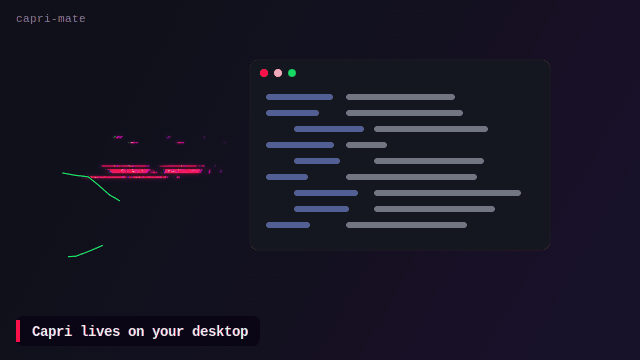

# capri-mate

Capri, from *Cyberpunk: Edgerunners* season 2, living on your Linux desktop. She holds still, glitches between
places, reacts when you poke her, and, if you give her an OpenAI key, talks back out loud.



She's built from the show's own frames, not redrawn: the background is cut away and her layers are put on bones in
Blender. Her new movements are timed the way the show animates her. The repo contains no art of hers.
`setup.sh` builds her sprites on your machine from the clip on YouTube.

## What she does

| | |
|---|---|
| **Stays put, then zaps** | She never drifts around. Every so often she tears into glitch slices, is gone for a beat, and glitches back in somewhere else, sometimes on your other monitor. |
| **Notices you** | Her eyes snap toward the cursor when it moves nearby. Bring it right up to her and she fades to a ghost and zaps away. Point at her face and she stays. |
| **Reacts** | Click: her hair flares, or she blinks off. Hover on her face: she grins. Drag: carry her anywhere; fling her and she zaps off that way. Double-click: teleport. Right-click: quiet for 30 min. |
| **Talks** *(optional)* | Middle-click her face. Type, or click `mic` and speak. She answers out loud, her mouth moving with her voice, and the bubble shows her words. |
| **Has a life** | Idles with long holds, turns her head sharply, perches on the window you're using, drops by when your cursor has been still a while, droops when you're away. Her sparkles glint; green energy flashes when she acts. |
| **Stays out of the way** | Click-through everywhere except a small spot on her face. Never takes the keyboard on her own. Hides while a window is fullscreen. Uses about 3% of one CPU core. |

## Setup

You need Linux on a **Wayland compositor with layer-shell**: Hyprland (best, all features), Sway, KDE Plasma,
river, Wayfire. GNOME has no layer-shell. Tested on openSUSE Tumbleweed with Hyprland.

```bash
git clone https://github.com/Spectro34/capri-mate && cd capri-mate
./setup.sh
```

`setup.sh` takes about 10 minutes the first time and is safe to re-run. It:

1. checks for GTK 4, gtk4-layer-shell, pycairo and ffmpeg, and offers your distro's install command if any are missing
2. makes a build venv (`.venv`, about 2 GB: CPU-only PyTorch, Hugging Face transformers, OpenCV, yt-dlp)
3. downloads the clip with yt-dlp (needs `node` or `deno`), or takes yours with `--video FILE`
4. cuts her out of the background with SAM 2
5. builds her rig and actions in Blender, if you have Blender 4.2 or newer (`--no-rig` skips this; she then has no reactions)
6. makes the sprites and starts the `capri-mate` systemd user service

Options: `--video FILE`, `--no-rig`, `--no-service`, `--height PX` (default 260).

If your compositor doesn't start `graphical-session.target`, start her yourself, e.g. in Hyprland:
`exec-once = systemctl --user start capri-mate`.

## Talking to her

```bash
mkdir -p ~/.config/capri-mate
install -m 600 /dev/stdin ~/.config/capri-mate/openai-key <<< "sk-..."   # your OpenAI API key
systemctl --user restart capri-mate
```

Then middle-click her face. One [OpenAI Realtime](https://platform.openai.com/docs/guides/realtime) session does the
listening, thinking and speaking. The conversation lives in memory only. Optional `~/.config/capri-mate/talk.json`:

```json
{ "model": "gpt-realtime-2.1-mini", "voice": "marin", "transcribe": "gpt-transcribe", "volume": 1.0,
  "persona": "You are Capri, ..." }
```

The mic needs PipeWire (`pw-record`) and a default input device.

## Controlling her

```bash
python3 mate.py ctl status                 # what she's doing, and where
python3 mate.py ctl hide | show | toggle   # e.g. bind toggle to a key
python3 mate.py ctl quiet 30               # hidden for 30 minutes
python3 mate.py ctl hop | blink | turn | poke | pet | look | bored
python3 mate.py ctl talk "hi Capri"        # say something to her (never takes the keyboard)
```

Flags for `mate.py` (put them in the service's `ExecStart`): `--monitors DP-1,HDMI-A-1`, `--layer overlay`,
`--opacity 0.8`, `--act-every 20,60`.

## How she's made

| Step | File | What it does |
|---|---|---|
| Cutout | `cutout.py` | Tracks her through the clip with [SAM 2](https://huggingface.co/facebook/sam2.1-hiera-base-plus). The mask's soft edge is then snapped to her cel colours, so her hair spikes come out clean and no room halo is left. Where the camera frame cuts her off, the edge fades out. |
| Rig | `rig/parts.py`, `rig/rig.py` | Splits one frame into layers (hair, head, irises, grin, body) and puts them on Blender bones. The hair is a grid bent by ten bones. Rendered at rest, the rig matches the original frame (mean difference 0.3/255). |
| Motion | `rig/rig.py` | Actions are timelines of held drawings, from measuring her in the show: about 3 drawings a second, on 2s and 3s at 24 fps, 1s only in fast moves. Poses snap instead of easing, the hair jumps as rigid shards, and glitch smears sit between big moves. |
| Sprites | `build_mate.py` | Scales everything to `--height`, anchors each frame on her face, adds a soft glow under her outline and lists her sparkles for the glints. |
| Mate | `mate.py`, `fx.py`, `talk.py` | GTK 4 layer-shell window. On Hyprland it reads the cursor and active window over IPC. |

`tools/make_demo.py` renders `docs/demo.gif` from your built sprites on a mock desktop.

## Not affiliated

A fan project. Capri and *Cyberpunk: Edgerunners* belong to CD PROJEKT RED, Studio Trigger and Netflix; this
repository contains none of their art except the short demo GIF. The code is MIT-licensed (see `LICENSE`).
